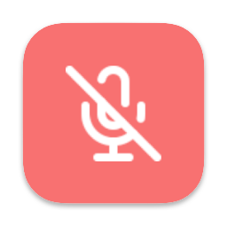
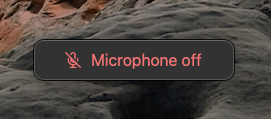

<p align="center">
  
</p>

<h1 align="center">Mic Mute for macOS</h1>

A system-wide mute for macOS microphones with a global shortcut and visual confirmation of mute status. Inspired by [VCM](https://learn.microsoft.com/en-us/windows/powertoys/video-conference-mute) for Windows.



Mute with <kbd>Cmd</kbd> <kbd>Shift</kbd> <kbd>M</kbd> or from the system tray dropdown. See the [settings documentation](./docs/settings.md) for the settings location, defaults, and available options.

## Features

- CoreAudio API mute input devices
  - [x] Mute input devices
    - Note: If native CoreAudio mute is unavailable, Mic Mute falls back to input volume controls, including virtual main volume. Devices exposing neither are skipped.
  - [x] Provide global hotkey muting
  - [x] Poll new devices to mute while microphones should be off
- Visual confirmation of mute status
  - [x] Show microphone mute status in system tray
  - [x] Show microphone mute status in small popup window
  - [x] Popup window shouldn't appear in screenshots or recordings and ignores mouse events
  - [x] Popup follows screens and monitors with cursor
- [x] Report whether camera is in use (disabling cameras appears to be impossible or too difficult for the scope of this project)
- [x] Add configurable settings (hotkey, startup, popup visibility)
- [x] Open app on system startup

## Limitations

Mic Mute is best-effort, **not** a hardware privacy switch.

- Mutes CoreAudio-controllable devices only.
- Skips devices without mute/volume controls, such as iPhone Continuity Microphone.
- Polling can leave brief mute gaps.
- Drivers can lie; use hardware mute, unplug, or macOS permissions for high assurance.

## Releases

I have not elected to sign the app by joining the Apple Developer Program. The releases have been self-signed by me and can be installed by bypassing the typical app security on macOS. You're also welcome to build and bundle the app yourself with the simple instructions described below.

[View releases](https://github.com/brettinternet/mic-mute/releases)

Pushing a version tag that matches `Cargo.toml` (for example `0.6.0`) runs the [Release workflow](./.github/workflows/release.yaml) on a macOS runner: the `task install` checks, an ad-hoc signed build, and a GitHub release with a DMG, `SHA256SUMS`, and a build provenance attestation. Running the workflow by hand with an existing tag republishes that release; without a tag, it only uploads the files as a workflow artifact. These builds aren't notarized, so macOS blocks the first launch until you choose **Open Anyway** in System Settings → Privacy & Security. To verify a download:

```sh
shasum -a 256 -c SHA256SUMS
gh attestation verify mic-mute-<version>-aarch64-apple-darwin.dmg --repo <owner>/mic-mute
```

## Build

Install dependencies with `mise`. Or you may [install Rust](https://www.rust-lang.org/tools/install). Then, [install go-task](https://taskfile.dev/installation/) or run the commands from the Taskfile separately yourself.

### Install

Build the app, install it to `/Applications`, and launch it:

```sh
task install
```

[`scripts/install.sh`](./scripts/install.sh) checks for macOS 11 or later on Apple silicon, the Xcode Command Line Tools, and the `aarch64-apple-darwin` Rust target, and installs the pinned cargo-bundle. It runs `cargo fmt --check`, clippy, and the tests, bundles and ad-hoc signs `Mic Mute.app`, and stops a running Mic Mute with SIGTERM, which restores the microphones. Then it replaces the installed copy atomically, points an existing Launch at Login agent at it, and launches it. Run it again to update. A locally built app isn't quarantined, so Gatekeeper doesn't block it.

Pass flags after `--`, for example `task install -- --user`:

| Flag | Effect |
| --- | --- |
| `--user` | Install to `~/Applications` instead of `/Applications` |
| `--skip-checks` | Skip the fmt, clippy, and test gates |
| `--no-launch` | Don't start the app after installing |
| `--bundle-only` | Stop after building, signing, and verifying the bundle |
| `--dry-run` | Run only the read-only checks; print every other command |

### Uninstall

```sh
task uninstall              # stop the app; remove it and its Launch at Login agent
task uninstall -- --purge   # also delete the settings
```

[`scripts/uninstall.sh`](./scripts/uninstall.sh) stops Mic Mute with SIGTERM, then deletes `Mic Mute.app` from `/Applications` and `~/Applications` (only copies whose bundle identifier is `com.brettinternet.mic-mute`) and `~/Library/LaunchAgents/com.brettinternet.mic-mute.plist`. It keeps `~/Library/Application Support/mic-mute` unless you pass `--purge`; `--dry-run` prints the commands instead of running them.

### Bundle only

Build and bundle the app without installing it:

```sh
task build
```

Once the build is complete, a Finder window opens to the bundle in `./target/aarch64-apple-darwin/release/bundle/osx` (`NO_OPEN=1 task build` skips it).

## Develop

[](https://github.com/brettinternet/mic-mute/actions/workflows/ci.yaml)
[](https://github.com/brettinternet/mic-mute/actions/workflows/audit.yaml)

### Setup

[Install Rust](https://www.rust-lang.org/tools/install). Then, [install go-task](https://taskfile.dev/installation/) or run the commands from the Taskfile separately yourself.

Install development dependencies.

```sh
task init
```

### Run

Run and watch for changes.

```sh
task start
```

### Build

```sh
task build
```

<details>
<summary>Release</summary>
Create a certificate to self-sign.

```sh
openssl req -x509 -newkey rsa:2048 -keyout sign.key -out sign.crt \
    -days 3650 -nodes -subj "/CN=mic-mute"
cat sign.key >> sign.crt
rm sign.key
```

Build a release.

```sh
task release
```

</details>
